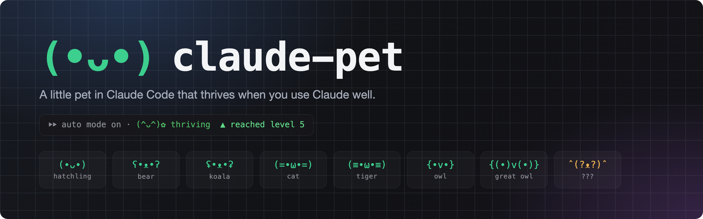
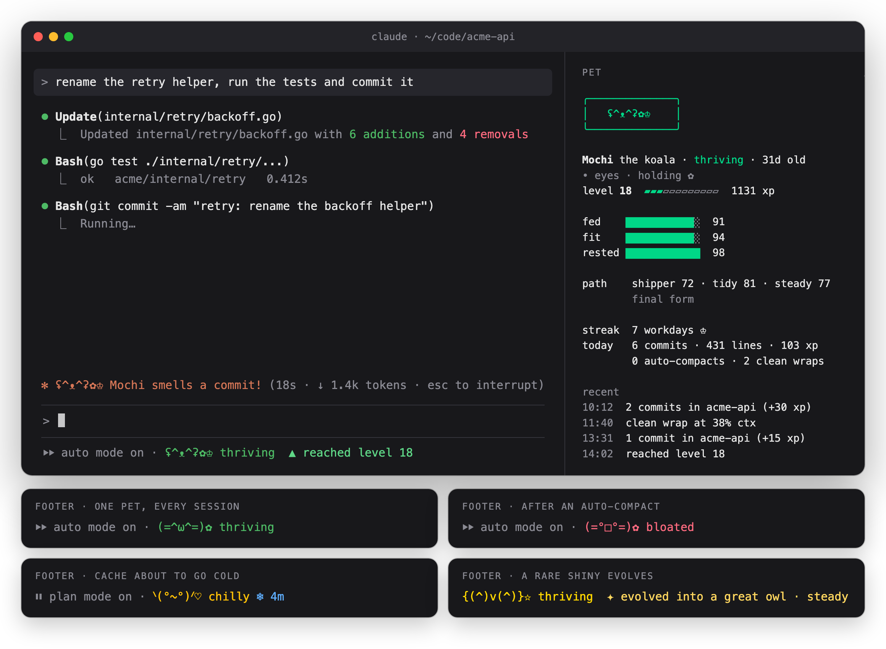

<p align="center"></p>

A little pet that lives in Claude Code. It does well when you use Claude well: shipping commits, keeping context lean, wrapping sessions cleanly, not redlining your rate limits. It sulks when neglected, and evolves into different creatures depending on how you work.

<p align="center"></p>

It's a Claude Code mod. The pet sits in the prompt footer next to the mode, coloured by its mood, and reacts in the spinner while Claude works. It never pops up, asks for anything or slows a tool call down: you glance at it or you don't.

- **The face** in the footer: green when it's happy, amber when it's meh, red when it's suffering, gold for a happy shiny.
- **Spinner reactions** while Claude works: sniffing around on searches, smelling a commit, getting restless on a long turn, stuffed when context runs heavy.
- **Milestones** flash next to the face for a few seconds: ✦ evolved, ▲ level up, ▽ devolved.
- **A ❄ countdown** before the session's prompt cache goes cold, so you know to send a message or wrap up.
- **`/pet`** opens the stat sheet in a pane beside the chat.

One pet is shared across every Claude session on the machine. Everything is local: state lives in a JSON file, the only external command is a local `git log`, and nothing touches the network.

## Install

```sh
curl -fsSL https://raw.githubusercontent.com/DanielAckroyd/claude-pet/main/install.sh | sh        # macOS / Linux
```
```powershell
irm https://raw.githubusercontent.com/DanielAckroyd/claude-pet/main/install.ps1 | iex             # Windows
```

That downloads the `claude-pet` binary, which keeps score, checks its checksum and runs setup. Pick **express** and say yes to installing the mod. Start a new Claude Code session and your pet hatches in the footer.

Setup backs up `~/.claude/settings.json` before touching it, keeps everything else in there exactly as it was, and is safe to re-run. **Custom** asks a few questions first: work hours, mod or statusline, and a name.

With Go installed, `go install github.com/DanielAckroyd/claude-pet@latest` then `claude-pet setup` works too, or grab a binary from the [releases page](https://github.com/DanielAckroyd/claude-pet/releases). To install the mod on its own, type this at a Claude Code prompt:

```
/plugin install claudepet --marketplace DanielAckroyd/claude-pet
```

It finds `claude-pet` on your PATH. Setup stores the full path instead, which also works when Claude Code is started from an app.

**With Claude Code:** paste this in.

> Install claude-pet by running `curl -fsSL https://raw.githubusercontent.com/DanielAckroyd/claude-pet/main/install.sh | sh` (on Windows, the install.ps1 line from https://github.com/DanielAckroyd/claude-pet), then run `claude-pet setup --express`, run the mod install command it prints, and show me the output.

For a custom setup through Claude, ask it to pass the options as flags: `--hours 8-16`, `--name NAME`, `--no-hooks`. Add `--dry-run` to preview first.

**Uninstall:** `claude plugin uninstall claudepet`, then `claude-pet setup --uninstall` to put your settings back the way they were. Delete the `claude-pet` binary (the install script puts it in `~/.local/bin`, or `%LOCALAPPDATA%\Programs\claude-pet` on Windows). Your pet stays in `~/.claude/pet` until you delete the folder.

<details>
<summary>On a Claude Code without mods</summary>

The pet started out in the statusline, and that still works on any Claude Code version. You get the face, but no spinner, flashes or pane:

```sh
claude-pet setup --statusline wrap      # put the pet in front of your statusline
claude-pet setup --statusline replace   # or use the bundled one (pet, model, context %)
```

Both add two hooks for scoring. Wrapping costs about 10ms per render. To build the pet into your own script instead, run setup with `--statusline skip` and call `--segment`, which prints only the pet:

```sh
input=$(cat)
pet=$(printf '%s' "$input" | claude-pet statusline --segment)
printf '%s │ %s' "$pet" "$(echo "$input" | jq -r .model.display_name)"
```

Set `"refreshInterval": 5000` on your `statusLine` so it animates between messages. The statusline command never fails; if anything goes wrong the pet just doesn't show. If you later move to the mod, `claude-pet setup` takes the pet back out of the statusline, and if your own script still draws it, the footer stays empty for that session so you don't see two.

</details>

## How it scores

| Stat | Goes up | Goes down |
|---|---|---|
| **fed** | Commits (+15), lines changed | Slowly over work hours |
| **fit** | Clean wraps: ending a session that shipped something while context is under 70% | Auto-compacts (-20, and it's bloated for 30 min), working in a session above 80% context, coming back to a session after its prompt cache expired (-5 per 100k tokens re-cached, max -15) |
| **rested** | Tracks your 5h rate limit usage, full while you're under 50% | Falls as you approach 100% |
| **xp** | Commits (x1.5 if context is under 50%), lines changed | Only when it devolves |

Decay only counts work hours (Mon to Fri, 09:00 to 17:00 local by default), so evenings and weekends are free. Manual `/compact` is neutral. Stats floor at 5 and the pet never dies. A streak counts weekdays with at least one commit that ended with fit ≥ 50, and at 5+ days it gets a crown ♔.

Two warnings show only in the session that triggered them, while every other session keeps the shared mood: **chilly** `(°~°)` when its prompt cache is about to expire, alongside the ❄ countdown, and **stuffed** `(•ε•)` when its context is over 70% or past 400k tokens. Neither changes stats; bloated and wilting still take priority.

Commits are counted from the repo you're working in, matched on that repo's `user.email`, so make sure it's set. Rate limit data only comes through on Claude subscription plans. On an API key, rested sits at a neutral 80 and the steady trait won't build.

## Evolution

The hatchling picks a species at L5 based on how you've worked over roughly the last 4 work hours, then a final form at L15 the same way. Final forms are locked.

```
(•ᴗ•) hatchling  (L1–4)
 ├─ shipper  ʕ•ᴥ•ʔ    bear      → seal ᶘ•ᴥ•ᶅ · koala ʢ•ᴥ•ʡ · dog U•ᴥ•U
 ├─ tidy     (=•ω•=)  cat       → tiger (≡•ω•≡) · neko /ᐠ•ꞈ•ᐟ\ · lynx /\•ω•/\
 ├─ steady   {•v•}    owl       → penguin <(•v•)> · dove ~(•v•)~ · great owl {(•)v(•)}
 └─ ???      ˆ(•ᴥ•)ˆ  fox       → wolf ᐡ•ᴥ•ᐡ · fennec ᐠ(•ᴥ•)ᐟ · kitsune ミᕱ•ᴥ•ᕱ彡
```

- **shipper:** committing regularly
- **tidy:** clean wraps, minus auto-compacts and cold caches
- **steady:** active time spent under 50% of your 5h limit
- The fox is the hidden one. You'll have to find it.

Each pet also rolls its own look when it hatches: eye style, a held charm (✿ ♡ ☆ ♣ ❀) and a 1 in 20 chance of being shiny, which shows as gold when it's happy.

**Devolving:** if fit and rested average under 30 for 90 minutes of active use, the pet wilts back a tier and loses a couple of levels. Its next evolution picks a branch fresh, so it might go a different way. Being away never devolves it. Only line or context changes count as activity, so a session left open in a terminal multiplexer doesn't count as you being there. You can also do it on purpose with `claude-pet devolve`.

## Commands

`/pet` at a Claude Code prompt opens the stat sheet in a pane. The binary has the rest:

```
claude-pet              stat sheet: face, level, stats, path, streak, today, recent events
claude-pet log [n]      recent events
claude-pet name NEW     rename
claude-pet tree         the evolution paths
claude-pet devolve      drop back a tier on purpose (asks first; -y skips the prompt)
claude-pet glyphs       every form × mood × frame, to check your terminal renders them evenly
claude-pet setup        wire it into Claude Code (or --custom, --uninstall)
```

It's a long name to type, so `alias pet=claude-pet` is worth adding. There's no reset command. Delete `~/.claude/pet/state.json` if you really mean it.

## Config

Put overrides in `~/.claude/pet/config.json`, which upgrades never touch. Any key from the tuning list in [`internal/pet/engine.go`](internal/pet/engine.go) works (`work_start`, `fed_per_commit`, `wilt_minutes` and so on), e.g. different work hours:

```json
{ "work_start": 8, "work_end": 16 }
```

Set `PET_DISABLE=1` to switch the pet off without uninstalling.

## Updating

Re-run the install script (or `go install github.com/DanielAckroyd/claude-pet@latest`), then `claude plugin update claudepet`. Your pet lives in `~/.claude/pet`, separate from both, so it carries over.

## Notes

- **The PreCompact hook:** setup keeps one hook in `settings.json` beside the mod. On Team and Enterprise plans, and on machines with managed settings, Claude Code runs a built-in security plugin ahead of everyone else's, and it can skip the mod's compact hook. The settings hook makes sure auto-compacts still get scored. When both fire, the second is ignored.
- **Multiple sessions:** they share state safely. Updates take a file lock, and a session that can't get the lock renders read-only. Per-session baselines mean lines are never counted twice.
- **Commits:** read with `git log --branches`, at most once a minute per repo, matched exactly on `user.email`. Amends and rebases don't count twice.
- **Platforms:** macOS, Linux and Windows, on amd64 and arm64. File locking uses `flock` on macOS and Linux, and `LockFileEx` on Windows. The mod is tested on Claude Code 2.1.318 in the terminal.
- **Tests:** `go test ./...` for the binary, which uses a temp `PET_HOME` and `HOME` so it never touches your real pet or settings. `claude plugin test mod` for the mod.
